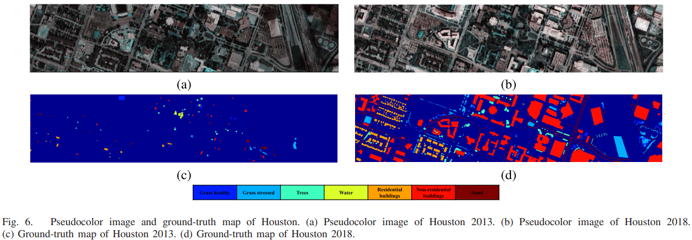
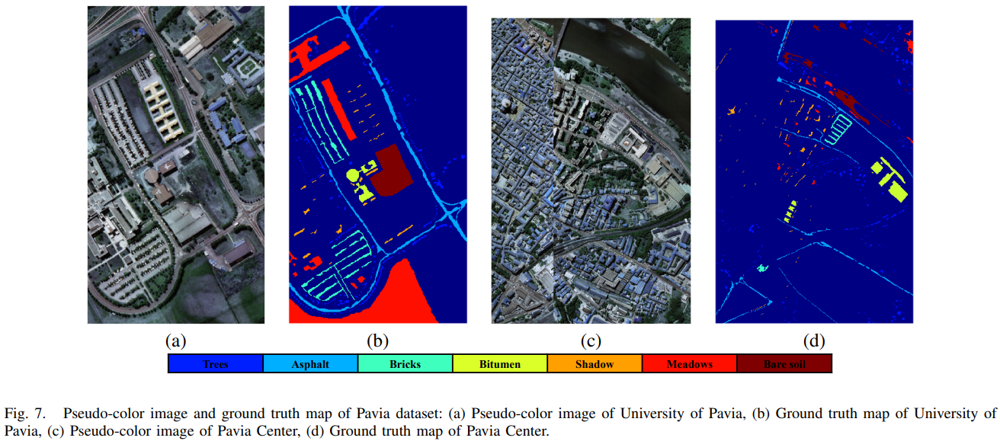

# Physics-Guided Domain Randomization and Spectral-Shape Invariant Representation for Cross-Scene Hyperspectral Image Classification

> **《物理引导域随机化与光谱形状不变表征的跨场景高光谱遥感分类研究》**  
> 完整执行计划书请查阅 👉 **[PLAN.md](./PLAN.md)**

---

## 🌟 项目简介 (Overview)

高光谱遥感图像（HSI）在跨时期、跨区域、跨传感器应用场景中，常因太阳高度角变化、大气瑞利/米氏散射差异及地表背景波动而产生严重的**光谱漂移（Spectral Shift）**。传统闭集分类模型在源域（Source Domain）训练后直接部署至未知目标域（Unseen Target Domain）时，分类精度往往大幅崩塌。

本项目构建了一套完整的**跨场景高光谱单源域泛化（Single-Source Domain Generalization, SDG）**研究框架，在经典基准模型 **SDEnet** (*IEEE TIP 2023*) 的基础上，提出三项物理与几何驱动的改进：

1. **物理波长感知的光谱域随机化 (`WavelengthPhysicalRandomization`)**：基于大气辐射传输幂律 $\tilde{\lambda}_c^{-\gamma}$ 与光照乘性增益 $\alpha$，在源域训练阶段生成符合真实光学物理规律的多样化跨场景样本。
2. **光谱形状（导数）引导的双流编码器 (`SpectralShapeDisentangledDiscriminator`)**：显式引入对加性大气偏移和乘性光照缩放天然免疫的一阶光谱斜率（$\Delta^1 X$）与二阶吸收谷曲率（$\Delta^2 X$），结合一维跨波段门控捕捉恒定的物质吸收峰几何轮廓。
3. **环境风格与物质本质的正交特征解耦 (`OrthogonalDisentangleLoss`)**：通过双投影头分离“场景不变物质特征 $Z_{\text{inv}}$”与“场景变化环境特征 $Z_{\text{env}}$”，施加正交内积约束 $\mathcal{L}_{\text{orth}}$ 彻底剥离源域光照残留。

---

## 📂 内置跨场景标准数据集 (Included Benchmark Datasets)

仓库已内置 **3 组国际公认的跨场景高光谱基准数据集**（位于 `./datasets/` 目录下，开箱即用）：

| 跨场景迁移任务 | 源域 (Source Domain) | 目标域 (Target Domain) | 波段数 | 共同类别数 | 场景特点 |
| :--- | :--- | :--- | :---: | :---: | :--- |
| **1. Houston 跨时相/跨传感器** | `Houston13` ($349 \times 1905$) | `Houston18` ($210 \times 954$) | 48 | 7 类 | 跨年份、不同空间分辨率与光照条件 |
| **2. Pavia 跨城区场景** | `paviaU` ($610 \times 340$) | `paviaC` ($1096 \times 715$) | 102 | 7 类 | 大学校园至市中心跨区域植被与建筑 |
| **3. HyRANK 农业与生态植被** | `Dioni` ($250 \times 1376$) | `Loukia` ($249 \times 945$) | 176 | 12 类 | 旱地农田、果树、橄榄林、针叶林等精细农业生态分类 |

> **注**：为兼容 GitHub 单文件 100MB 限制，`datasets/Pavia/paviaC.mat` (129MB) 已无损拆分为 `paviaC.mat.part1` 与 `paviaC.mat.part2`；运行训练脚本时，`utils_HSI.py` 中的 `open_file()` 会**全自动检测并秒级无损合并**为 `paviaC.mat`，无需任何手动操作。

<p align="center">
  
  
</p>

---

## 🚀 快速开始 (Quick Start)

### 1. 环境依赖 (Requirements)
```bash
pip install torch numpy scipy h5py scikit-learn pandas matplotlib spectral tqdm tensorboardX imageio
```

### 2. 一键运行本文提出的方法 (`train_ours.py`)

* **任务 1：Houston 跨场景泛化 (`Houston13` $\rightarrow$ `Houston18`)**
```bash
python train_ours.py --data_path ./datasets/Houston/ --source_name Houston13 --target_name Houston18 --re_ratio 5 --training_sample_ratio 0.8 --d_se 64 --lambda_1 1.0 --lambda_2 1.0 --lambda_orth 0.5
```

* **任务 2：Pavia 跨场景泛化 (`paviaU` $\rightarrow$ `paviaC`)**
```bash
python train_ours.py --data_path ./datasets/Pavia/ --source_name paviaU --target_name paviaC --re_ratio 1 --training_sample_ratio 0.5 --d_se 64 --lambda_1 1.0 --lambda_2 1.0 --lambda_orth 0.5
```

* **任务 3：HyRANK 农业与生态跨场景泛化 (`Dioni` $\rightarrow$ `Loukia`)**
```bash
python train_ours.py --data_path ./datasets/HyRANK/ --source_name Dioni --target_name Loukia --re_ratio 1 --training_sample_ratio 0.8 --d_se 64 --lambda_1 1.0 --lambda_2 1.0 --lambda_orth 0.5
```

---

## 🧪 消融实验一键命令 (Ablation Study Commands)

通过控制 `--use_phys_aug`、`--use_spec_diff`、`--use_orth_loss` 三个开关，可直接跑出论文第四章表 2 的完整消融实验数据：

```bash
# Exp 1: Baseline (关闭全部三项改进)
python train_ours.py --data_path ./datasets/Houston/ --source_name Houston13 --target_name Houston18 --use_phys_aug 0 --use_spec_diff 0 --use_orth_loss 0

# Exp 2: Baseline + 创新点1 (物理波长感知域随机化)
python train_ours.py --data_path ./datasets/Houston/ --source_name Houston13 --target_name Houston18 --use_phys_aug 1 --use_spec_diff 0 --use_orth_loss 0

# Exp 3: Baseline + 创新点1 + 创新点2 (光谱导数形状引导流)
python train_ours.py --data_path ./datasets/Houston/ --source_name Houston13 --target_name Houston18 --use_phys_aug 1 --use_spec_diff 1 --use_orth_loss 0

# Exp 4: Ours Full (完整模型：物理域随机化 + 光谱导数形状流 + 正交特征解耦损失)
python train_ours.py --data_path ./datasets/Houston/ --source_name Houston13 --target_name Houston18 --use_phys_aug 1 --use_spec_diff 1 --use_orth_loss 1
```

---

## 📖 参考文献与致谢 (References & Acknowledgements)

本项目基线代码与跨场景数据集构建参考自北京理工大学李伟教授、张宇翔博士团队的开源工作：
* Y. Zhang, W. Li, W. Sun, R. Tao, and Q. Du, *"Single-Source Domain Expansion Network for Cross-Scene Hyperspectral Image Classification,"* **IEEE Transactions on Image Processing (TIP)**, vol. 32, pp. 1498–1512, 2023.
* [YuxiangZhang-BIT/IEEE_TIP_SDEnet](https://github.com/YuxiangZhang-BIT/IEEE_TIP_SDEnet) & [YuxiangZhang-BIT/Data-CSHSI](https://github.com/YuxiangZhang-BIT/Data-CSHSI)
